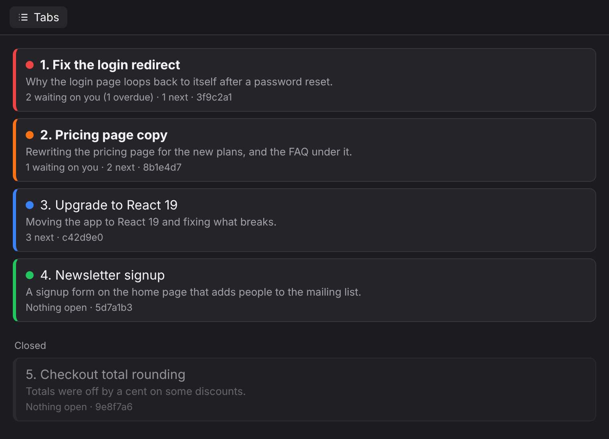
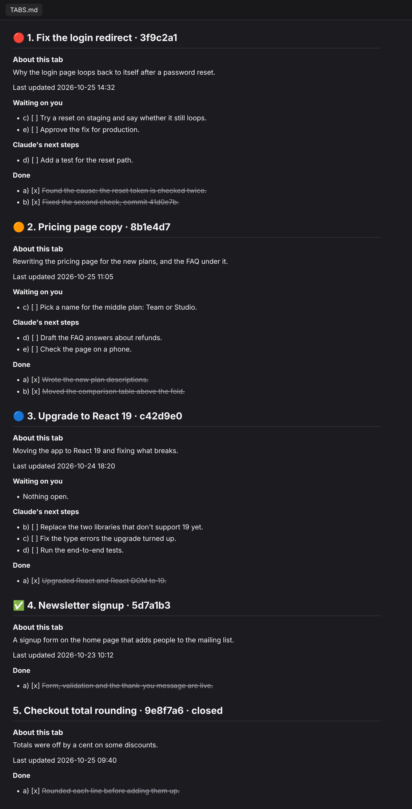
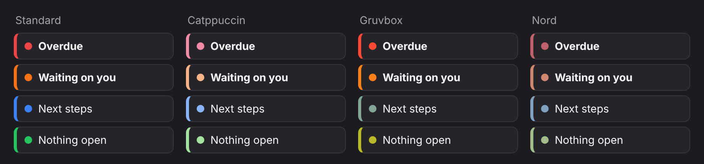

# paseo-tabs

paseo-tabs keeps a live checklist of every [Paseo](https://paseo.sh) tab in a `TABS.md` file at the top of your repository, and adds a Tabs panel that jumps to any tab.



Each tab gets a section headed by a dot showing where it stands, its number in the tab bar, its name and a short ID. The agent in that tab keeps the section current: what it is waiting on you for, its next steps, and what it has done. Items are lettered, so you can say "2b" for tab 2, item b. Keep `TABS.md` open beside a chat and you can see where every tab stands without scrolling back through each one.

```markdown
## 🟠 1. Fix the login redirect · 3f9c2a1

### About this tab
Why the login page loops back to itself after a password reset.

Last updated 2026-10-24 16:59

**Waiting on you**
- c) [ ] Try a reset on staging and say whether it still loops.

**Claude's next steps**
- d) [ ] Add a test for the reset path.

**Done**
- a) [x] ~~Found the cause: the reset token is checked twice.~~
- b) [x] ~~Fixed the second check, commit 41d0e7b.~~
```

`TABS.md` is plain Markdown, so you can read and change it outside Paseo too, in any text editor or in Obsidian. To tick an item, put an x in its box. While the Paseo daemon runs, the plugin notices the edit within a couple of seconds and updates the tab's dot. The dots are written into the file, red ones included, so they show wherever you open it. The file holds no dates, which keeps it easy to edit by hand. The plugin keeps item ages in a small file of its own, outside `TABS.md` and outside Paseo.

The repository holds two plugins. The Paseo plugin keeps every `TABS.md` in step with your tabs and adds the Tabs panel. The Claude Code plugin gives each Claude tab the rule for its section when it starts.

## Install

You need Paseo 0.11.0 or later, for both the daemon and the app, with your tabs running Claude Code. You also need plugins turned on in Paseo, under Settings, Plugins.

Install the Paseo plugin from a shell on the machine that runs the Paseo daemon:

```
paseo plugin install github:sh0nuff/paseo-tabs
```

Then install the Claude Code plugin, inside Claude Code:

```
/plugin marketplace add sh0nuff/paseo-tabs
/plugin install paseo-tabs@paseo-tabs
```

New tabs get the rule as they start. A tab that is already open gets it when it resumes or compacts.

## Remove

```
paseo plugin remove paseo-tabs
```

```
/plugin uninstall paseo-tabs@paseo-tabs
/plugin marketplace remove paseo-tabs
```

Existing `TABS.md` files stay where they are. Delete them, and the `TABS.md` line in each repository's `.git/info/exclude`, if you don't want them.

## What it does

### Keeping TABS.md in step

The Paseo plugin reads Paseo's agent and workspace records, and checks each `TABS.md`, every 2 seconds. It updates a `TABS.md` whenever its tabs change, an edit changes what is open, or an item turns overdue.



- It creates `TABS.md` only at the top level of a git repository that has an open Claude tab. Whenever it writes the file, it makes sure `TABS.md` is in that repository's `.git/info/exclude`, so the file is never committed, even when a tab created it by hand. In a worktree, the line goes in the main repository's exclude file.
- Tabs are numbered in the order they were opened, matching the tab bar. Headings follow renames.
- Each open tab's heading starts with a dot. 🔴 means an item has waited on you, unchanged, for longer than your limit. 🟠 means something in its section waits on you, 🔵 that only its next steps are open, and ✅ that nothing is open. A new tab and closed tabs get no dot.
- To know how long an item has waited, the plugin notes when each item under "Waiting on you" last changed. It keeps this in its own file under `$XDG_STATE_HOME/paseo-tabs/` (`~/.local/state/paseo-tabs/` when that variable is unset), one file for each Paseo home. `TABS.md` itself never gets dates. Rewording an item restarts its clock, and ticking it off or removing it forgets it. Items that were already open when the plugin was installed start counting from then.
- The plugin shortens long names, usually Paseo's copy of a first message, for display. Stray quotes and openers go, the first clause stays, and an ellipsis marks a cut. The names in Paseo stay as they are.
- When a folder has tabs from more than one Paseo workspace, each workspace's tabs sit under a `# <workspace name> · <short id>` line, numbered on their own.
- A closed tab's section moves to the bottom of its workspace, marked ` · closed`. It stays while anything in it is open, and goes once nothing in it is open and the tab has been closed for 24 hours. Any unticked box counts as open, at any indent. A list line starting with "- Nothing" doesn't.
- It keeps sections it doesn't recognise, and any text above the first heading, as written.
- It changes only headings, group lines and the order of sections. The text under each heading belongs to that tab. Before writing, it re-reads the file, so an edit made a moment earlier, by an agent or by you, is not lost.

### The Tabs panel

Open it with Ctrl+K (⌘K on macOS) and "Open Tabs". It lists the workspace's tabs in tab-bar order, each with its dot, its "About this tab" line, and how many items are waiting on you, overdue and next. Tabs waiting on you are bold, and each row's edge takes its dot's colour. Tapping a tab opens it. Below the open tabs, dimmed, it lists closed tabs that still have a section.

The panel draws its dots, so they show in colour on any machine. The dots in `TABS.md` are emoji, which need a colour emoji font.

Paseo's own `paseo://` tab links do nothing when clicked inside Paseo, which is why the panel exists.

### Settings

Find these in Paseo under Settings, Plugins, Tabs.

| Setting | What it changes | Default |
|---|---|---|
| Status dots | The dots in `TABS.md` and the panel | On |
| Shorten long names | The shortened display names | On |
| Longest name | How many characters a shortened name keeps, from 25 to 80 | 40 |
| Overdue after | How long an item may wait on you, unchanged, before its tab turns red: 3 days, 1 week, 2 weeks, 30 days, or never | 1 week |
| Palette | The panel's colours: Standard, Catppuccin, Gruvbox or Nord, each in a dark or light version to match your Paseo theme | Standard |



Every `TABS.md` picks up a changed setting at once.

### The rule each tab gets

The Claude Code plugin's SessionStart hook runs only inside Paseo, in a folder that is the top level of a git repository. It gives the tab [the rule](claude/rule.md) with its ID and the path to `TABS.md` filled in. Outside Paseo it does nothing.

The rule also asks a tab that still carries Paseo's automatic name, the start of its first message, to give itself a short name once its topic is clear, and to do the same for a workspace whose name reads like a message. Tabs you named keep their names. This needs Paseo's own tools inside agents, which the daemon setting `daemon.mcp.injectIntoAgents` turns on.

### Closed tabs

You can bring a closed tab back by sending it a message, and its section and letters stay valid. Claude Code deletes a conversation's transcript after 30 days by default, after which the tab comes back without its history. To keep transcripts longer, set `cleanupPeriodDays` in `~/.claude/settings.json`, for example `"cleanupPeriodDays": 365`.

If a tab can't come back, a new tab can take over its section. It puts its own ID in the heading, keeps the letters and items, and notes `Continues <old id>`.

## Opening TABS.md beside a chat

In Paseo, press Ctrl+K, choose Files, right-click `TABS.md` and choose "Open to the side". The pane refreshes as the file changes.

## Development

```
npm install
npm test
npm run typecheck
```

Tests use Node's built-in runner and need Node 22.18 or later. `node tools/sync-once.ts --dry-run` prints what one sync pass would change in your real `TABS.md` files, and writes nothing. It uses the default settings, not the ones saved in Paseo.

The pictures are drawn from the HTML in `assets/src/`, with made-up tabs, and `assets/src/render.sh` redraws them.

## License

MIT
