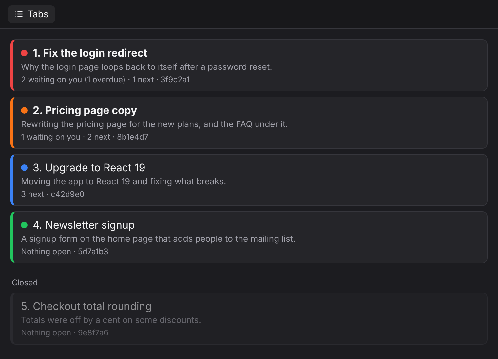

# paseo-tabs

paseo-tabs adds a Pending panel to [Paseo](https://paseo.sh): one list per workspace of everything its Claude tabs are waiting on you for. Each tab keeps its own items current with a few agent tools, so you can see what needs you without scrolling back through every chat, pick the next item with one tap, and tell a tab an item is done.



Each card in the panel shows four lines:

- what the item is, in bold
- the action, what you do
- about how many minutes your part takes
- how long it has waited ("Waiting since today", "Waiting 3 days"), and why it matters when the tab gave a reason

Tap a card to pick it: the tab gets a message starting `Picked from the panel:` and starts on it with you. "Mark done" under a card tells the tab you finished it; the tab checks what it can and closes the item. A search box under the cards finds open items in every workspace and opens the workspace you tap. Each workspace's row in Paseo's sidebar also gets a line with its most urgent tab and the first item waiting on you.

The repository holds two plugins that work together: a Paseo plugin (the panel, the sidebar line, the agent tools and the store) and a Claude Code plugin (the rule each Claude tab gets, and two hooks that keep its list honest).

## Install

You need Paseo 0.17.0 or later for both the daemon and the app, plugins turned on under Settings, Plugins, and tabs running Claude Code. The command-line helper the tabs fall back to needs Node 22.18 or later.

Install the Paseo plugin from a shell on the machine that runs the Paseo daemon:

```
paseo plugin install github:sh0nuff/paseo-tabs
```

Then install the Claude Code plugin, inside Claude Code on the same machine:

```
/plugin marketplace add sh0nuff/paseo-tabs
/plugin install paseo-tabs@paseo-tabs
```

New tabs get the rule as they start. A tab that is already open gets it when it resumes or compacts. Open the panel with Ctrl+K (Cmd+K on macOS) and "Open Pending".

## Remove

```
paseo plugin remove paseo-tabs
```

```
/plugin uninstall paseo-tabs@paseo-tabs
/plugin marketplace remove paseo-tabs
```

The store stays in `~/.local/state/paseo-tabs/` (or `$XDG_STATE_HOME/paseo-tabs/`). Delete that folder if you don't want it.

## How tabs use it

Every Claude tab gets five tools:

| Tool | What it does |
|---|---|
| `pending_add` | Adds an item. `kind` is `waiting` (something you do or decide) or `next` (the tab's own next step). `what`, `action`, `minutes` and `why` are all required. |
| `pending_update` | Changes fields of one of the tab's items, by letter. |
| `pending_done` | Closes one of the tab's items as `done` or `dropped`, with an optional note. |
| `pending_list` | Lists the tab's open items. |
| `pending_find` | Finds other tabs to hand work to, live ones and ones whose workspace was archived in the last 30 days, by words from the workspace or tab name or an ID prefix. |

The rule each tab gets ([claude/rule-pending.md](claude/rule-pending.md)) asks it to say every ask in full in the chat and add it to the panel at once, close items the moment there is evidence they are done, and never add an item it can check itself. Two hooks back this up: before each of your messages the tab sees its open items and is asked to reconcile them, and a tab that did real work in a turn without touching its list is stopped once and asked to reconcile before it finishes.

Messages from the panel:

- `Picked from the panel: <what>. Action: ... About N min. Why: ... (item x)` means you chose that item. The tab restates it and starts on it.
- `Done from the panel: <what>. The user says this is finished. (item x)` means you did it. The tab checks what it cheaply can, closes the item, and offers the remaining ones.

A pick or Mark done is sent at once. A running tab gets it steered into its turn, and a tab stopped on a question is interrupted, since the pick supersedes the question.

**Handing work to another tab.** A tab finds the other tab with `pending_find`, then messages it with Paseo's `send_agent_prompt`. When the work waits on you, it adds a `waiting` item for that tab with the command-line helper, `node <plugin folder>/tools/pending.ts add --agent <id> --json '{...}'`, so the item shows in that tab's workspace.

The rule also asks each tab to name itself for its task, and the first tab in a workspace to name the workspace for its topic, when Paseo's tools are available inside agents (`daemon.mcp.injectIntoAgents`).

To add your own lines to the rule, put them in `~/.local/state/paseo-tabs/rule-extra.md`. They are appended to the rule each tab gets.

## Settings

Find these in Paseo under Settings, Plugins, Tabs.

| Setting | What it changes | Default |
|---|---|---|
| Mode | Pending panel, or the 1.x TABS.md file (legacy) | Pending panel for a new install; TABS.md file for an install upgraded from 1.x, until you switch or migrate |
| Archive finished workspaces | When every item in a workspace is closed, the tab ends its reply with "Nothing further waiting on you." and the workspace is archived about 10 minutes later. A new item waiting on you brings it back | Off (on for installs migrated from 1.x with the cut-over marker, until you turn it off) |
| Status dots | The coloured dot on each workspace's sidebar line | On |
| Shorten long names | Shortened display names; the names in Paseo stay as they are | On |
| Longest name | How many characters a shortened name keeps, 25 to 80 | 40 |
| Overdue after | How long an item may wait on you, unchanged, before its tab's dot turns red | 1 week |
| Palette | The dot colours: Standard, Catppuccin, Gruvbox or Nord | Standard |
| Workspace order, Remove finished items | TABS.md file mode only | Newest first, On |

**Auto-archive in detail.** With it on, a workspace is archived only when every pending item in it is closed and nothing has moved for 10 minutes: no message, no item change, no typing in a message box in the last 3 minutes and no voice dictation in the last 5. Pinned workspaces, and ones a schedule or heartbeat targets, are never archived. The tab's Stop hook asks for the closing line and schedules the archive (with `systemd-run --user` where it exists, else a background timer); a sweep in the daemon every 5 minutes covers tabs whose hook never loaded. A new `waiting` item for a tab whose workspace was archived restores the workspace; a plain message runs the tab but leaves the workspace archived. With it off, none of this runs and the rule just asks the tab to end with "Nothing further waiting on you."

## Migrating from 1.x (TABS.md)

1.x kept each tab's items in a `TABS.md` file at the top of the repository. 2.0 keeps them in a store, one JSON file per workspace under `~/.local/state/paseo-tabs/pending/`. An upgraded 1.x install keeps working as before: it stays in TABS.md mode until you switch.

To move your open items into the panel:

1. Import each `TABS.md` into the store. Run it first without `--write` to see what it would import, one line per workspace:

   ```
   node <plugin folder>/tools/pending-import.ts /path/to/repo/TABS.md
   node <plugin folder>/tools/pending-import.ts /path/to/repo/TABS.md --write
   ```

   Items keep their letters. Running it twice adds nothing.
2. Switch Mode to Pending panel in the settings, or create the cut-over marker. The marker keeps the Pending panel on for good and turns auto-archive on unless you turn it off:

   ```
   touch ~/.local/state/paseo-tabs/pending/cutover
   ```

With the marker, `TABS.md` is kept as a read-only view of the store for 7 days, for anything that still reads it, and then left alone. The 1.x code is kept on the `v1` branch.

## Requirements and limits

- Paseo 0.17.0 or later, daemon and app. The panel and the agent tools need it.
- Claude Code tabs get the tools and the rule. Tabs from other providers get no tools; their items never show.
- The plugin cannot open the panel beside a chat or split the view for you. Open it from the Command Center.
- Typing is detected from Paseo's message boxes. On a phone, it is seen only while a workspace's row is on screen in the sidebar, or while the message box is open.
- Voice dictation is detected from the daemon's log, for all workspaces at once, so dictating anywhere holds every auto-archive back for 5 minutes.
- The store is local to the machine that runs the daemon. The plugin sends nothing over the network.
- Tested on Linux.

## What it reads and writes

- Paseo's agent and workspace records in the daemon's home folder (`~/.paseo`, or `$PASEO_HOME`), and the plugin's saved settings there.
- Its own state under `~/.local/state/paseo-tabs/` (or `$XDG_STATE_HOME/paseo-tabs/`): the store in `pending/`, typing activity in `activity.json`, archived tabs (kept 30 days) in `archived-tabs.json`, and per-tab markers in `auto-archive/`.
- In TABS.md mode only, `TABS.md` and `TABS-DONE.md` at the top of each git repository with an open Claude tab, kept out of git through `.git/info/exclude`, and an item clock in the state folder.
- With auto-archive on, it runs `paseo workspace archive` and `paseo agent inspect`, and restores workspaces through the client library that ships with Paseo's CLI. It finds the CLI on `PATH`, else in `$(npm root -g)/@getpaseo/cli`; set `PASEO_CLI_ROOT` to that folder if it lives elsewhere.

## Development

```
npm install
npm test
npm run typecheck
```

Tests use Node's built-in runner and need Node 22.18 or later. Every test works in temporary folders. `node tools/pending.ts sweep --dry-run` prints what the daemon's sweep would archive, and archives nothing. The pictures are drawn from the HTML in `assets/src/` with made-up tabs; `assets/src/render.sh` redraws them.

## License

MIT
